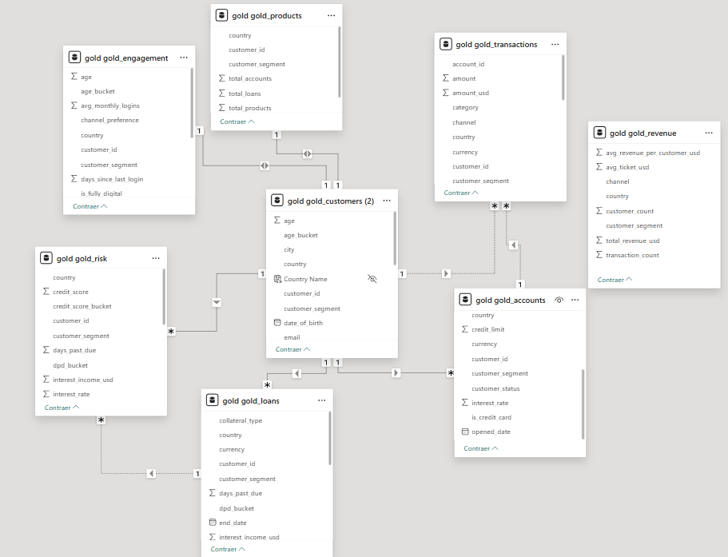
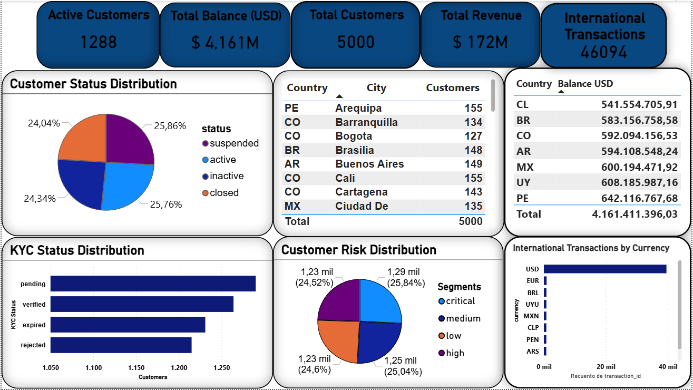
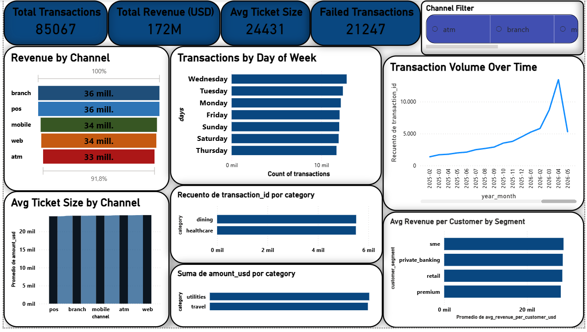
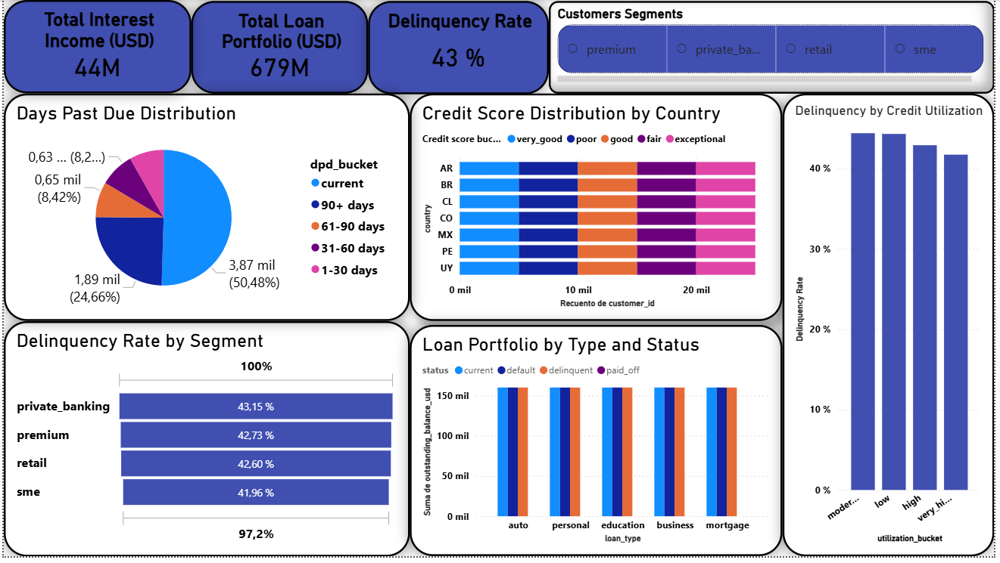
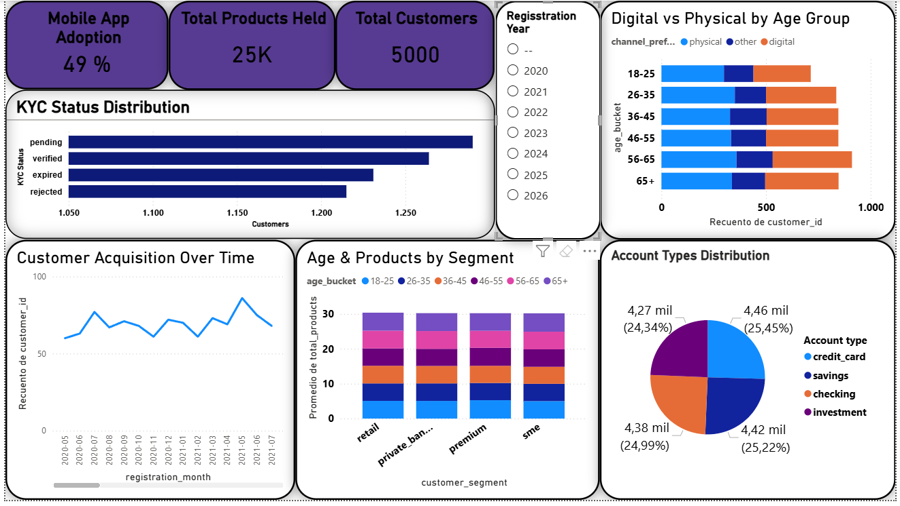

# Qversity Data Engineering Project 2026
## Fintech/Banking Data Pipeline with PySpark, dbt & PowerBI

**Juan Pedro Ferreira** | fjuanpedro93@gmail.com | Montevideo, Uruguay | Cohort 2026

---

## Table of Contents

1. [Project Overview](#1-project-overview)
2. [Architecture](#2-architecture)
3. [Run the Pipeline](#3-run-the-pipeline)
4. [Data Model](#4-data-model)
5. [PySpark Logic](#5-pyspark-logic)
6. [Gold Layer & Business Questions](#6-gold-layer--business-questions)
7. [Key Business Insights](#7-Key-Business-Insights)
8. [Assumptions & Design Decisions](#8-assumptions--design-decisions)
9. [Git Tags / Milestones](#9-git-tags--milestones)
10. [Project Structure](#10-project-structure)

---

## 1. Project Overview

### Business Problem

A fictional LATAM fintech company operating across 7 countries (Colombia, Uruguay, Argentina, Mexico, Chile, Peru and Brazil) needs to turn raw customer data into actionable business insights. The data arrives as a complex nested JSON file containing 5,100 customer records, each with multiple accounts, transactions, loans, credit information, digital engagement metrics and more.

### Goals

- Build a production-grade ELT pipeline that ingests, transforms and exposes this data for analytics
- Answer 24 specific business questions covering revenue, risk, customer demographics, transaction patterns, digital engagement and product analysis
- Present insights through a 4 page PowerBI dashboard connected directly to the gold schema
- Apply the knowledge of multiple technologies learned in the course

### Architecture Diagram

```
S3 (fintech_banking_dataset.json)
│
▼
Apache Airflow (DAG: qversity_fintech_pipeline)
│
▼
BRONZE (PostgreSQL, schema=bronze)
- Raw JSON stored as jsonb
- 5,100 records ingested, 5,000 after dedup
│
├──────────────► PySpark (inside Airflow container)
│                - Flatten nested arrays (accounts, transactions, loans)
│                - Flatten nested objects (credit_info, digital_engagement)
│                - Deduplicate by primary key using ROW_NUMBER()
│                - Write 6 staging tables to schema=silver
│
▼
dbt Silver (PostgreSQL, schema=silver)
- Clean and normalize PySpark staging outputs
- Translate mixed Spanish/English values to English
- Parse 4 different date formats into standard dates
- Fix 33 city typos, normalize phone formats
- Build dim_customers, dim_accounts, dim_credit_info,
  dim_digital_engagement, fct_transactions, fct_loans
- 39 dbt tests all passing
│
▼
dbt Gold (PostgreSQL, schema=gold)
- 8 analytics models answering all 24 business questions
- 107 dbt tests all passing (Silver + Gold)
│
▼
PowerBI Desktop
- 4 page dashboard connected to gold schema
- 24/24 business questions answered
```

## 2. Architecture

### Technology Stack

| Tool | Version | Role |
|------|---------|------|
| Docker & Docker Compose | Latest | Containerized development environment |
| PostgreSQL | 15+ | Data warehouse (bronze/silver/gold schemas) |
| Apache Airflow | 2.7+ | Pipeline orchestration |
| PySpark | 3.5+ | Array flattening and deduplication |
| dbt-core + dbt-postgres | 1.7+ | SQL transformations and testing |
| PowerBI Desktop | Latest | Dashboard and data visualization |
| Python | 3.11+ | DAGs and PySpark scripts |


### Why a Custom Dockerfile for Airflow?

The base Airflow image (`apache/airflow:2.7.3`) does not include Java or PySpark. We built a custom `Dockerfile.airflow` that adds:

- **Java 17** — required by PySpark (runs on the JVM)
- **PySpark 3.5.0** — for flattening nested JSON arrays
- **dbt-core 1.7.17 + dbt-postgres** — to run Silver and Gold transformations from the DAG
- **PostgreSQL JDBC driver** — for PySpark to read/write from PostgreSQL

Without this custom image, the `spark_flatten` task would fail because PySpark cannot run without Java.

### Layer Responsibilities

**Bronze** Persists raw data from S3 as JSONB in PostgreSQL. No transformations. Provides full traceability to the original source.

**Silver (PySpark)** Reads Bronze via JDBC, explodes nested arrays into relational tables using `explode()`, deduplicates using `ROW_NUMBER()` partitioned by primary key. Writes 6 staging tables back to PostgreSQL.

**Silver (dbt)** Cleans and normalizes PySpark staging outputs: translates Spanish/English mixed values, parses 4 date formats, fixes typos, handles disguised nulls. Builds 4 dimensions and 2 fact tables with 39 passing tests.

**Gold (dbt)** Builds 8 analytics-ready models with explicit business logic (revenue definition, delinquency flags, USD conversion, age/risk/credit buckets). All 24 business questions answerable from Gold. 107 total tests passing.

**PowerBI** Connects directly to PostgreSQL gold schema. 4 page dashboard.

## 3. Run the Pipeline

### Prerequisites

- Docker Desktop installed and running
- Git
- PowerBI Desktop

### Environment Setup

```bash
# Clone the repository
git clone https://github.com/JuanPedroFerreira/qversity-data-2026-montevideo-juanpedroferreira.git
cd qversity-data-2026-montevideo-juanpedroferreira
cd qversity-data-final-project-2026-main

# Copy environment file
# Windows:
copy env.example .env
# Linux/Mac:
cp env.example .env
```

The `.env` file should contain:

```
# Docker Compose Configuration
COMPOSE_PROJECT_NAME=qversity

# Airflow Configuration
AIRFLOW_UID=50000
AIRFLOW_PROJ_DIR=.
_AIRFLOW_WWW_USER_USERNAME=admin
_AIRFLOW_WWW_USER_PASSWORD=admin

# PostgreSQL Configuration
POSTGRES_USER=qversity-admin
POSTGRES_PASSWORD=qversity-admin
POSTGRES_DB=qversity

# dbt Configuration
DBT_PROFILES_DIR=/dbt
DBT_PROJECT_DIR=/dbt

# S3 Data Source
S3_BUCKET=qversity-raw-public-data
S3_KEY=fintech_banking_dataset.json
S3_DATASET_URL=https://qversity-raw-public-data.s3.amazonaws.com/fintech_banking_dataset.json
```

### Install Pre-commit Hooks (optional but recommended)

```bash
pip install pre-commit
pre-commit install
```

This project uses pre-commit hooks to enforce code quality on every commit:
- **black** — Python code formatting
- **isort** — import ordering
- **flake8** — style and quality checks
- **pyupgrade** — modernizes Python syntax

### Start with Docker

```bash
# Build and start all services
docker compose up -d --build

# Verify all services are healthy
docker compose ps
```
### Verify Installation

```bash
# PostgreSQL
docker compose exec postgres psql -U qversity-admin -d qversity -c "SELECT version();"

# Airflow
docker compose exec airflow airflow version

# PySpark
docker compose exec airflow python -c "import pyspark; print(pyspark.__version__)"

# Python
docker compose exec airflow python --version

# dbt
docker compose exec airflow bash -c "cd /opt/airflow/dbt && dbt --version"
```


### Trigger the Airflow DAG

```bash
# Trigger the full pipeline
docker compose exec airflow airflow dags trigger qversity_fintech_pipeline

# Check in the Airflow UI
# Open http://localhost:8080
# Login: admin / admin
# It may take a few seconds to open.
```

The DAG runs 5 tasks in sequence:
```
ingest_bronze → spark_flatten → dbt_run_silver → dbt_run_gold → dbt_test
```
### Connect PowerBI to PostgreSQL

1. Open PowerBI Desktop
2. Click **Get Data** → **More...** → search for **PostgreSQL**
3. Enter the connection details:
   - **Server:** `localhost:5432`
   - **Database:** `qversity`
4. Click **OK** → enter credentials:
   - **Username:** `qversity-admin`
   - **Password:** `qversity-admin`
5. In the Navigator, expand `qversity` → `gold` and select all 8 tables:
   - `gold_accounts`, `gold_customers`, `gold_engagement`, `gold_loans`
   - `gold_products`, `gold_revenue`, `gold_risk`, `gold_transactions`
6. Click **Load**

> Note: Docker must be running with PostgreSQL healthy before connecting PowerBI.

### Key dbt Commands

```bash
# Run all models
docker compose exec airflow bash -c "cd /opt/airflow/dbt && dbt run --profiles-dir /opt/airflow/dbt --target dev"

# Run only Silver models
docker compose exec airflow bash -c "cd /opt/airflow/dbt && dbt run --profiles-dir /opt/airflow/dbt --target dev --select silver"

# Run only Gold models
docker compose exec airflow bash -c "cd /opt/airflow/dbt && dbt run --profiles-dir /opt/airflow/dbt --target dev --select gold"

# Run all tests
docker compose exec airflow bash -c "cd /opt/airflow/dbt && dbt test --profiles-dir /opt/airflow/dbt --target dev"

# Run tests for a specific model
docker compose exec airflow bash -c "cd /opt/airflow/dbt && dbt test --profiles-dir /opt/airflow/dbt --target dev --select gold_customers"
```

---

## 4. Data Model

### Silver Layer — Core Tables

```
dim_customers (5,000 rows)
│   customer_id (PK)
│   first_name, last_name, email, phone_number
│   country, city, gender, nationality
│   customer_segment, status, kyc_status
│   risk_score, registration_date, date_of_birth
│   is_valid_email
│
├──── dim_accounts (17,374 rows
│         account_id (PK), customer_id (FK)
│         account_type, currency, balance
│         credit_limit, interest_rate
│         opened_date, status, branch_code
│
├──── fct_transactions (85,067 rows)
│         transaction_id (PK), account_id (FK), customer_id (FK)
│         transaction_date, amount, currency
│         transaction_type, category, merchant
│         channel, status, description
│
├──── fct_loans (7,353 rows)
│         loan_id (PK), customer_id (FK)
│         loan_type, currency, principal
│         outstanding_balance, interest_rate
│         term_months, monthly_payment
│         start_date, end_date, status
│         days_past_due, collateral_type
│
├──── dim_credit_info (5,000 rows — one per customer)
│         customer_id (PK/FK)
│         credit_score, utilization_pct
│         total_limit, total_used
│         num_credit_accounts, late_payments_12m
│         inquiries_6m, bankruptcy_flag
│
└──── dim_digital_engagement (5,000 rows — one per customer)
          customer_id (PK/FK)
          mobile_app_registered, web_banking_registered
          last_login_date, avg_monthly_logins
          preferred_channel, push_notifications
          paperless_statements
```

## Architecture — 8 Gold Models

| Model | Grain | Questions |
|-------|-------|-----------|
| `gold_customers` | One row per customer | Q9, Q10, Q11, Q12, Q13, Q14 |
| `gold_transactions` | One row per transaction | Q15, Q16, Q17, Q18, Q19 |
| `gold_revenue` | One row per segment + channel + country | Q1, Q3 |
| `gold_risk` | One row per customer-loan combination | Q4, Q5, Q6, Q7, Q8 |
| `gold_engagement` | One row per customer | Q20, Q21 |
| `gold_accounts` | One row per account | Q2, Q22 |
| `gold_loans` | One row per loan | Q8, Q23 |
| `gold_products` | One row per customer | Q11, Q24 |

### Gold Layer — Analytics Models




## 5. PySpark Logic

### Script: `spark/flatten_bronze.py`

**Purpose**: Read raw JSONB records from `bronze.raw_fintech_data` and explode nested arrays and objects into 6 relational staging tables in the `silver` schema.

**What it flattens**:

| Array/Object | Output Table | Method |
|---|---|---|
| Customer flat fields | `silver.stg_customers` | Direct field extraction from JSONB |
| `accounts[]` | `silver.stg_accounts` | `explode()` on the accounts array |
| `transactions[]` | `silver.stg_transactions` | `explode()` on the transactions array |
| `loans[]` | `silver.stg_loans` | `explode()` on the loans array |
| `credit_info{}` | `silver.stg_credit_info` | Nested object field extraction |
| `digital_engagement{}` | `silver.stg_digital_engagement` | Nested object field extraction |

**How deduplication works**:

```python
# For each staging table, apply ROW_NUMBER() partitioned by primary key
# ordered by load_timestamp DESC — keeping only the most recent record

windowSpec = Window.partitionBy("customer_id").orderBy(desc("load_timestamp"))
df = df.withColumn("row_num", row_number().over(windowSpec))
df = df.filter(col("row_num") == 1).drop("row_num")
```

This eliminated 100 duplicate customer records (5,100 → 5,000). Duplicates existed because the source dataset contained repeated `customer_id` values with slightly different `load_timestamp` values.

**JDBC configuration**: PySpark reads from and writes to PostgreSQL using the JDBC driver. Connection parameters are injected via Airflow environment variables.

## Bronze Layer

### What it does

The Bronze layer has one single job: **store the raw data exactly as it arrives, without touching anything**.

The goal is to always have the original data available in case something goes wrong in later stages, so you can reprocess from scratch without going back to S3.

### How the ingestion works

The process is orchestrated by Apache Airflow, which runs the `ingest_bronze`, the first step of the pipeline:

```
1. Airflow triggers the DAG
         │
         ▼
2. Downloads the JSON file from S3
   (https://qversity-raw-public-data.s3.amazonaws.com/fintech_banking_dataset.json)
         │
         ▼
3. Parses the JSON and separates the 5,100 customer records
         │
         ▼
4. Inserts each record as one row in bronze.raw_fintech_data
```

### What the raw data looks like

```json
{
  "customer_id": "CUST-0000001",
  "first_name": "María",
  "last_name": "García",
  "country": "UY",
  "risk_score": 42.5,
  "accounts": [
    { "account_id": "ACC-001", "type": "savings", "balance": 15000 },
    { "account_id": "ACC-002", "type": "credit_card", "balance": 3200 }
  ],
  "transactions": [
    { "transaction_id": "TXN-001", "amount": 500, "type": "deposit" }
  ],
  "loans": [...],
  "credit_info": { "credit_score": 720, "utilization_pct": 0.35 },
  "digital_engagement": { "mobile_app_registered": true, "avg_monthly_logins": 12 }
}
```

### Why we store everything without transforming

**Traceability** As already mentioned, if something goes wrong in Silver or Gold, we can always revert to the original data and reprocess it from scratch without having to download the S3 file again.

**Flexibility** If we need to extract a field we're not currently using, the data is already in Bronze. Nothing is lost.

### Results

| Metric | Value |
|--------|-------|
| Records loaded | 5,100 customers |
| Format | JSONB in PostgreSQL |
| Source | AWS S3 public bucket |
| Duplicates in Bronze | 0 — table is truncated before each load to guarantee idempotency |
| Duplicates removed by PySpark | 100 — identified in Silver during flattening using ROW_NUMBER() |

**Design decision**: We truncate because the dataset is static. In a real production use case with daily changing data, we would use an append strategy with deduplication by `customer_id` and `load_timestamp`.


## Silver Layer

### The problem to solve

After Bronze, we had 5,100 raw JSON records in PostgreSQL. Before answering any business question we needed to:

1. **Explode** all nested arrays into separate relational tables
2. **Clean the data** fix typos, normalize mixed languages, handle nulls and more
3. **Validate** data quality with automated tests

## The Silver layer phases


### Phase 1 — PySpark: Flattening & Deduplication

#### Why PySpark is good?

PySpark is built for this kind of work, it handles nested structures natively with `explode()` and `from_json()` and scales very well.

#### Staging tables created by PySpark

The script `spark/flatten_bronze.py` reads from `bronze.raw_fintech_data` via JDBC and creates 6 tables in the `silver` schema. These are intermediate tables, data is already in relational format but not cleaned or normalized:

| Table | Records | Source |
|-------|---------|--------|
| `stg_customers` | 5,000 | Flat JSON fields |
| `stg_accounts` | 17,374 | `accounts[]` array |
| `stg_transactions` | 87,990 | `transactions[]` array |
| `stg_loans` | 7,353 | `loans[]` array |
| `stg_credit_info` | 5,000 | `credit_info{}` object |
| `stg_digital_engagement` | 5,000 | `digital_engagement{}` object |

#### How deduplication works

A record is a duplicate if it shares the same primary key (`customer_id`, `account_id`, `transaction_id`, or `loan_id`). We used `ROW_NUMBER()` with a window partitioned by the primary key and ordered by `load_timestamp DESC` keeping only the most recent record:

```python
windowSpec = Window.partitionBy("customer_id").orderBy(desc("load_timestamp"))
df = df.withColumn("row_num", row_number().over(windowSpec))
df = df.filter(col("row_num") == 1).drop("row_num")
```

This eliminated 100 duplicate customer records (5,100 → 5,000).

### Phase 2 — EDA: What we found in the data

Before cleaning, we ran exploratory queries directly against the staging tables in DBeaver to understand quality issues. All queries and findings are documented in `dbt/analyses/`. Key findings:

#### Mixed languages
The dataset had values in both Spanish and English with no consistency:
- Customer status: `activo`, `inactivo`, `cerrado`, `suspendido` mixed with `active`, `inactive`, `closed`, `suspended`
- Transaction types: `deposito`, `retiro`, `pago`, `reembolso`, `comision` mixed with English equivalents
- Account status: `activo`, `cerrado`, `congelado` mixed with English values (`active`, `closed`, `frozen`)
- Segments: `minorista`, `pyme`, `banca_privada` mixed with `retail`, `sme`, `private_banking`
- KYC status: `verificado`, `pendiente`, `expirado`, `rechazado` mixed with `verified`, `pending`, `expired`, `rejected`
- Transaction channels: `movil` → `mobile`, `sucursal` → `branch` mixed with English values
#### 4 different date formats in the same column
- `YYYY-MM-DD` (most common)
- `DD/MM/YYYY`
- `YYYYMMDD`
- `MM-DD-YYYY`
#### Disguised nulls
In multiple columns, null values were stored as text: `'n/a'`, `'NA'`, `'null'`, `'Null'`, `'NULL'`, `''` (empty string). Affected fields include `gender`, `relationship_manager`, `collateral_type`, `category`, `merchant`and `description`.

#### Extra whitespace
Multiple fields contained leading, trailing and duplicate internal spaces — for example `"  dining"`, `"dining  "`, `" dining "`. Cleaned using `TRIM()` on `category`, `merchant`, `description`, `collateral_type`, `account_type` and `channel`. First and last names were additionally normalized with `regexp_replace('\s+', ' ')` to collapse multiple internal spaces into one and `initcap()` to standardize capitalization.

#### City name typos
33 cities had typos: `Cusc` → `Cusco`, `Lma` → `Lima`, `Santiag` → `Santiago`, `Sao Paulp` → `Sao Paulo`, etc.

#### 4 different phone number formats
- `+56 4737213290` (with spaces)
- `(+51) 8476691953` (with parentheses)
- `2594972204` (no country prefix)
- `+51-214-8591079` (with dashes)
#### Other findings
- `utilization_pct` had two formats: `0.35` (decimal) and `35` (percentage as integer) — normalized everything to 0-1
- 2,052 emails had invalid format — flagged with `is_valid_email` instead of discarding
- 492 credit scores outside valid range 300-850 — filtered out in Silver (`credit_score between 300 and 850` applied in `dim_credit_info`)
- Transactions with NULL `amount` — filtered out in `fct_transactions` (`amount is not null`)
- 15 transaction categories had inconsistent formatting with leading/trailing spaces and disguised nulls (`N/A`, `NA`, `null`) — resulting in 15 clean values: dining, education, entertainment, groceries, healthcare, insurance, investment, other, rent, salary, shopping, subscription, transport, travel, utilities

### Phase 3 dbt: Cleaning & Normalization

#### Models built

- `dim_` tables describe *who or what* — static attributes like customer name, country, or segment.
- `fct_` tables record *what happened* — events over time like transactions or loans.

We replaced the staging tables with 6 clean dimension and fact tables:

**Dimensions:**
- `dim_customers` — normalized and validated customer attributes
- `dim_accounts` — account details per customer
- `dim_credit_info` — credit scoring and utilization data
- `dim_digital_engagement` — digital adoption metrics
**Facts:**
- `fct_transactions` — all transaction records
- `fct_loans` — loan portfolio data
#### Key cleaning decisions

**Date normalization** — Created a `parse_date` macro that autodetects the format:

```sql

    case
        when {{ field }} ~ '^\d{4}-\d{2}-\d{2}$' then {{ field }}::date
        when {{ field }} ~ '^\d{2}/\d{2}/\d{4}$' then to_date({{ field }}, 'DD/MM/YYYY')
        when {{ field }} ~ '^\d{8}$'              then to_date({{ field }}, 'YYYYMMDD')
        when {{ field }} ~ '^\d{2}-\d{2}-\d{4}$' then to_date({{ field }}, 'MM-DD-YYYY')
        else null
    end

```

**Language normalization** — CASE statements translate all Spanish values to English across all models.

**Null normalization** — `'n/a'`, `'na'`, `'null'`, `''` converted to real NULL using `TRIM() + LOWER() + CASE`.

**Whitespace normalization** — `TRIM()` applied to all text fields. First and last names additionally processed with `regexp_replace('\s+', ' ')` to collapse internal spaces and `initcap()` to standardize capitalization.

**City typo correction** — 33 known typos corrected with hardcoded CASE statements. In the future, a string similarity library (such as `fuzzywuzzy` in Python or the `pg_trgm` extension in PostgreSQL) could be used to automatically handle new unseen typos without manual intervention.

**Phone normalization** — Removed parentheses, spaces and dashes; added country prefix for numbers missing it based on the customer's `country` field.

**Email validation** — Instead of discarding 2,052 invalid emails, added a `is_valid_email` boolean flag for downstream filtering.

**Utilization normalization** — Detected two formats (0.35 vs 35) and normalized everything to decimal 0-1.

**Credit score filtering** — Records with `credit_score` outside the valid range 300-850 are excluded in `dim_credit_info`. This removed 492 records.

**Transaction filtering** — Records with NULL `amount` are excluded in `fct_transactions`.

---

### Phase 4 dbt Tests

We implemented 39 automated tests covering:

**Uniqueness** Primary keys on all 6 models

**Not-null** Critical fields (customer_id, email, country, amount, etc.)

**Accepted values** dbt verifies that each categorical field only contains the expected values. For example, `status` only accepts `active`, `inactive`, `suspended`, `closed`, if any other value appears, the test fails. This is applied to all categorical fields (status, segments, channels, loan types, etc.)

**Referential integrity** All facts and dimensions reference `dim_customers`:
- `dim_accounts.customer_id` → `dim_customers`
- `fct_transactions.customer_id` → `dim_customers`
- `fct_transactions.account_id` → `dim_accounts`
- `fct_loans.customer_id` → `dim_customers`
- `dim_credit_info.customer_id` → `dim_customers`
- `dim_digital_engagement.customer_id` → `dim_customers`

**Custom test** `test_credit_score_range.sql` validates all scores are between 300-850.

**Result: 39/39 tests passing.**

---

### Technical Debt

**City typo correction hardcoding vs robust solution**

We currently correct city name typos with hardcoded CASE statements:

```sql
when 'Lma' then 'Lima'
when 'Cusc' then 'Cusco'
```

The problem is that if future data arrives with a new unseen typo (`Carcas` instead of `Caracas`), the pipeline won't correct it. In production, the correct solution would be to use string similarity libraries (like `fuzzywuzzy` in Python or the `pg_trgm` extension in PostgreSQL) that compare each city against a reference table and pick the closest match.

Due to time constraints, hardcoding is sufficient for this static dataset.


## 6. Gold Layer & Business Questions

### What does this layer do?

The Gold layer takes clean, normalized data from Silver and transforms it into analytics-ready tables designed to answer all 24 business questions. Each Gold model has a clearly defined grain and business logic documented explicitly.


### Business Definitions

**Revenue** completed transactions (`status = 'completed'`) of type `payment` or `fee`. Deposits and transfers are excluded because they do not represent income for the institution.

**Delinquent** a loan is delinquent when `status IN ('delinquent', 'default')` OR `days_past_due > 0`. The OR condition covers cases where status has not yet been updated but overdue days already exist.

**Interest income** `outstanding_balance * interest_rate / 100` applied only to loans with `status = 'current'`. Loans with status `delinquent`, `default` and `paid_off` generate zero computable interest.

**International transaction** when the transaction currency does not match the customer's local currency: CO→COP, UY→UYU, AR→ARS, MX→MXN, CL→CLP, PE→PEN, BR→BRL. USD and EUR are always international for all countries in the dataset since no customer has USD or EUR as their local currency.

**USD conversion** approximate exchange rates as of May 2026: ARS=0.001, BRL=0.18, CLP=0.001, COP=0.00024, MXN=0.05, PEN=0.27, UYU=0.025, EUR=1.08. This conversion is approximate, in production we would use a daily-updated exchange rate table from an official source.

**Age buckets** 18-25, 26-35, 36-45, 46-55, 56-65, 65+

**Risk buckets** low (0-25), medium (26-50), high (51-75), critical (76-100)

**Credit score buckets** poor (300-579), fair (580-669), good (670-739), very_good (740-799), exceptional (800-850). Range per project specification.

**DPD buckets** current (0 days), 1-30 days, 31-60 days, 61-90 days, 90+ days

### Note on paid_off loans

The dataset includes loans with `status = 'paid_off'`. These loans have a non-null `outstanding_balance` but represent fully cancelled debt. For this reason, `interest_income_usd` explicitly excludes `paid_off` loans only `current` loans generate computable interest. `delinquent` and `default` loans also generate zero interest as they are not meeting payment obligations.

### Business Questions by Dashboard Page

### Page 1   Executive Overview

**Q2   What are the total account balances by country?**
**Visual**: Table right side  columns: Country, Balance USD
**Model**: `gold_accounts` (field `balance_usd`)

Balances converted to USD for cross-country comparability. Peru leads with $642M, followed by Uruguay ($608M), Mexico ($600M), Argentina ($594M), Colombia ($592M), Brazil ($583M) Chile ($541M). Total: $4,161M USD.

Assumption: local currency balances converted to USD using approximate May 2026 exchange rates.

**Q9  How do risk scores segment customers (low/medium/high/critical)?**
**Visual**: Pie chart "Customer Risk Distribution" (bottom center)
**Model**: `gold_customers` (field `risk_bucket`)

Shows how many customers fall into each risk category: critical (~25.84%), medium (~25.04%), high (~24.6%), low (~24.52%). The uniform distribution across all four buckets indicates that the dataset was synthetically generated with balanced risk profiles. In a real dataset, we would expect a skew toward low and medium risk.

**Q10  What is the customer count by country and city?**
**Visual**: Table "Customers by Country & City"
**Model**: `gold_customers`

Direct count of customers by country and city. Cities were normalized in Silver  33 typos corrected. Brazil and Peru lead with 737 customers each, Chile has the lowest with 666. The city with the most customers is Arequipa, Peru. Total: 5,000 customers across 7 LATAM countries.

**Q13   What is the customer status breakdown (active/inactive/suspended/closed)?**
**Visual**: Pie chart "Customer Status Distribution"
**Model**: `gold_customers` (field `status`)

Distribution by status: suspended (25.86%), active (25.76%), inactive (24.34%), closed (24.04%). Only 25.76% of customers are currently active  a significant business concern that warrants a customer reactivation strategy.

**Q14  What is the KYC status distribution?**
**Visual**: Bar chart "KYC Status Distribution"
**Model**: `gold_customers` (field `kyc_status`)

Count by kyc_status: pending 1,290, verified 1,264, expired 1,231, rejected 1215. Pending leads slightly  a compliance alert that requires urgent attention since unverified customers represent a legal and regulatory risk.

**Q19 — What are the international transfer patterns (by currency/country)?**
**Visual 1**: KPI card "International Transactions" (top right — 46,094)
**Visual 2**: Bar chart "International Transactions by Currency"
**Model**: `gold_transactions` (fields `is_international` and `local_currency`)

A transaction is international when its currency does not match the customer's local country currency. Of 85,067 total transactions, 46,094 are international (54%).

The bar chart shows the breakdown by currency, USD dominates international transactions across all countries. This makes sense because no customer in the dataset has USD as their local currency (the 7 countries use COP, UYU, ARS, MXN, CLP, PEN, BRL), so any USD transaction is automatically international.

To see international transaction patterns filtered by specific country, use the country table.


### Page 2 — Revenue & Transactions

**Q1 — What is the average revenue per customer by segment?**
**Visual**: Bar chart "Avg Revenue per Customer by Segment"
**Model**: `gold_revenue` (field `avg_revenue_per_customer_usd`)

Revenue calculated as the sum of completed transactions of type `payment` and `fee`, grouped by segment, divided by customer count per segment. SME leads in avg revenue per customer, followed by private_banking, retail and premium. Differences between segments are small.

---

**Q3 — What is the revenue breakdown by transaction channel?**
**Visual**: Stacked bar chart "Revenue by Channel"
**Model**: `gold_revenue` (field `total_revenue_usd`)

Revenue grouped by channel: branch ($36M), pos ($36M), mobile ($34M), web ($34M), atm ($33M).

---

**Q15 — What are the most common transaction categories by volume and value?**
**Visual 1**: Bar chart "Top Categories by Volume" (shows dining and healthcare as top 2)
**Visual 2**: Bar chart "Top Categories by Value" (shows utilities and travel as top 2)
**Model**: `gold_transactions` (fields `category`, `transaction_id`, `amount_usd`)

Two separate bar charts filtered to Top 2 to answer both parts of the question:
- **By volume**: dining leads 5519 transactions, followed by healthcare.
- **By value**: utilities leads in total amount_usd, followed by travel.

Important:
The most frequent categories are not the ones that move the most money.

---

**Q16 — What is the transaction volume by day of week?**
**Visual**: Bar chart "Transactions by Day of Week"
**Model**: `gold_transactions` (fields `day_of_week` and `day_name`)

Result: Wednesday leads (12,827 transactions), Thursday is lowest (11,692). Weekdays significantly outnumber weekends, suggesting that it is primarily business activity.

---

**Q17 — What is the average transaction size by channel?**
**Visual**: Bar chart "Avg Ticket Size by Channel"
**Model**: `gold_transactions` (field `amount_usd`)

Shows the average dollar amount per transaction for each channel, calculated as `AVG(amount_usd)`. All channels show similar avg ticket (~$24,000 USD). The minimal difference between channels indicates that the channel chosen by the customer does not influence how much money they transact.

---

**Q18 — What is the failed transaction rate by channel?**
**Visual**: KPI card "Failed Transactions"
**Model**: `gold_transactions` (field `is_failed`)

`is_failed = (status = 'failed')`. Of 85,067 total transactions, 21,247 failed. Failure rate is consistent across channels no single channel fails significantly more than others.

Note: Use the channel filter to see the failure rate per channel.

---

### Page 3 — Risk & Credit

**Q4 — What is the interest income by loan type?**
**Visual 1**: KPI card "Total Interest Income (USD)"
**Visual 2**: Bar chart "Loan Portfolio by Type and Status" ( click on each loan type to filter the KPI)
**Model**: `gold_loans` (field `interest_income_usd`) and `gold_risk`

`interest_income_usd = outstanding_balance_usd * interest_rate / 100` for loans with `status = 'current'` only. Loans with `paid_off`, `delinquent` and `default` status have `interest_income_usd = 0`. Total estimated annual interest income: $44M USD on the current active loan portfolio. To see interest income broken down by loan type, click on each bar in the "Loan Portfolio by Type and Status" chart — the KPI filters automatically.

---

**Q5 — What is the loan delinquency rate by customer segment?**
**Visual 1**: KPI card "Delinquency Rate"
**Visual 2**: Bar chart "Delinquency Rate by Segment"
**Model**: `gold_risk` (field `is_delinquent`)

Percentage of records with `is_delinquent = true` over total, grouped by customer segment. Private banking has the highest rate (43.15%), SME the lowest (41.96%). The overall rate is 43% — nearly half of all loans have some payment issue. Differences across segments are small, indicating delinquency is a systemic problem across the entire portfolio rather than concentrated in a specific customer type.

Note: `gold_risk` grain is customer-loan (a customer with 3 loans appears 3 times). The rate reflects the proportion of delinquent loans, not delinquent customers.

---

**Q6 — What is the credit score distribution by country?**
**Visual**: Stacked bar chart "Credit Score Distribution by Country"
**Model**: `gold_risk` (field `credit_score_bucket`)

Stacked bar chart with country on the Y axis and credit score buckets (very_good, poor, good, fair, exceptional) as legend colors. Each country shows a perfectly uniform distribution of ~20% per bucket. This reflects the synthetic dataset design — in a real dataset we would expect variation between countries, with some markets showing higher concentrations of poor or fair scores depending on their local credit culture and economic conditions.

---

**Q7 — Is there a relationship between credit utilization and delinquency?**
**Visual**: Bar chart "Delinquency by Credit Utilization"
**Model**: `gold_risk` (fields `utilization_bucket` and `is_delinquent`)

Credit utilization measures what percentage of available credit a customer is using. For example, if someone has a $10,000 credit limit and currently owes $3,000, their utilization is 30% — which falls in the "moderate" bucket. The chart shows the delinquency rate for each utilization level: moderate (~47%), low (~47%), high (~45%), very_high (43%).

---

**Q8 — What is the days past due distribution?**
**Visual**: Pie chart "Days Past Due Distribution" (top left)
**Model**: `gold_loans` (field `dpd_bucket`)

50.48% of loans are current (paid on time). 24.66% are 31-60 days past due — this is the most urgent collections priority since these customers can still be recovered with timely intervention. 8.42% are 61-90 days past due, 8.26% are 90+ days (likely irrecoverable) and 8.18% are 1-30 days past due.

---

**Q23 — What is the loan portfolio composition (by type and status)?**
**Visual**: Stacked bar chart "Loan Portfolio by Type and Status" (bottom center — status as legend: current/default/delinquent/paid_off)
**Model**: `gold_loans` (fields `loan_type`, `status`, `outstanding_balance_usd`)

Outstanding balance grouped by `loan_type` with `status` as the legend, converted to USD. Auto loans lead ($142M total), followed by personal ($135M), education ($130M), business ($128M) and mortgage ($120M). The stacked bars show the composition of each loan type by status — the blue (current) portion represents healthy loans, orange (delinquent) and dark blue (default) represent at-risk loans and purple (paid_off) represents fully cancelled debt.

Total outstanding portfolio: $679M USD.

Assumption: 219 loans with NULL `outstanding_balance` in Silver are loans without available balance information. Kept as NULL in Gold.


---

### Page 4 — Customer & Engagement

**Q11 — What is the age distribution by customer segment?**
**Visual**: Stacked bar chart "Age & Products by Segment"
**Model**: `gold_products` (with `age_bucket` from `gold_customers`)

Age is calculated in Gold using `date_part('year', age(current_date, date_of_birth))`. It is not stored in Silver because it is a time-varying derived field. The stacked bar chart uses `age_bucket` as the legend color, showing which age groups are present within each customer segment. The 56-65 group (pink) is consistently the largest across all segments, while 18-25 (light blue) is the smallest.

---

**Q12 — What is the customer acquisition trend over time?**
**Visual**: Line chart "Customer Acquisition Over Time"
**Model**: `gold_customers` (field `registration_month`)

Monthly count of new customers grouped by `registration_month` (YYYY-MM format). Acquisition is stable between 60 and 85 new customers per month since May 2020, with a slight upward trend toward 2021.

---

**Q20 — What is the mobile app adoption rate by segment?**
**Visual**: KPI card "Mobile App Adoption"
**Model**: `gold_engagement` (field `mobile_app_registered`)

The 49% means that of 5,000 customers, approximately 2,450 have downloaded and registered on the mobile banking app (`mobile_app_registered = TRUE`). More than half of customers are not yet using the app. SME has the highest adoption rate (49.92%) and retail the lowest (47.58%) differences are small across segments. To see adoption filtered by a specific segment, use the table Age & Prodcuts by Segment.

---

**Q21 — What is the digital vs branch preference by age group?**
**Visual**: Stacked bar chart "Digital vs Physical by Age Group"
**Model**: `gold_engagement` (field `channel_preference`)

Channel preference classification: digital = mobile or web (remote, app-based banking), physical = branch or atm (in-person banking), other = pos and phone.

---

**Q22 — What are the most popular account types?**
**Visual**: Pie chart "Account Types Distribution"
**Model**: `gold_accounts` (field `account_type`)

Count of accounts by type: credit_card (4,461 — 25.45%), savings (4,421 — 25.22%), checking (4,380 — 24.99%), investment (4,267 — 24.34%). Near-uniform distribution across all four types, no account type dominates.

---

**Q24 — What is the average number of products per customer by segment?**
**Visual**: Stacked bar chart "Age & Products by Segment"
**Model**: `gold_products` (field `total_products`)

Products defined as accounts + loans per customer. Calculated using separate CTEs to avoid row multiplication from JOINs. All segments average around 5 products per customer, no segment stands out.. The stacked bar chart answers both Q24 (products by segment) and Q11 (age distribution by segment) simultaneously, making efficient use of dashboard space.

Assumption: products defined as bank accounts + loans only. Other financial products not present in the dataset are excluded.



---

## dbt Tests

107 tests total (Silver + Gold), all passing:

- **Uniqueness** — PKs on all Gold models
- **Not-null** — critical fields on all models
- **Accepted values** — all categorical fields and buckets
- **Referential integrity** — Silver maintains dim_*/fct_* relationships

Note: `balance_usd` in `gold_accounts` and `outstanding_balance_usd` in `gold_loans` do not have not_null tests because there are 486 and 219 nulls respectively — balances that came as NULL from the original dataset, kept as NULL by deliberate decision not to impute.

---

## Technical Debt

**Exchange rates** are hardcoded as of May 2026, in production these would come from a daily-updated source like a Central Bank API.

**gold_risk is one row per customer-loan**, not per customer. A customer with 3 loans appears 3 times. PowerBI aggregations need to account for this.

**balance_usd was removed from gold_revenue** because the grain (segment + channel + country) caused the balance to multiply when aggregating. Q2 uses gold_accounts instead, which has one row per account.
---

## 7. Key Business Insights

- **Only 25.76% of customers are active**  74% are suspended, inactive, or closed. For a fintech this is a serious problem, most of the customer base is gone.
- **43% loan delinquency rate**  nearly half of all loans have payment issues, and it's spread evenly across all segments and loan types. Not a problem with one specific group.
- **54% of transactions are international**  USD dominates across all 7 countries. Makes sense since none of the local currencies are USD, so any dollar transaction counts as international.
- **1 in 4 transactions fails**  21,247 out of 85,067. Failure rate is the same across all channels so the problem is probably upstream, not channel-specific.
- **Mobile app adoption is 49%**  half the customers have never logged in through the app.
- **Revenue is almost identical across all channels and segments**  branch, mobile, web, atm all within a few million of each other. No clear winner.
- **Wednesday has the most transactions, Thursday the fewest**  weekdays are much busier than weekends.
- **Credit scores are perfectly uniform (~20% per bucket per country)**  this is a synthetic dataset, real data would never look like this.

## 8. Assumptions & Design Decisions

### Data Quality Assumptions

- **Null balances** (504 accounts, 219 loans) kept as NULL. No imputation applied. These are records without available balance information in the source system.
- **240 customers registered under age 18** kept in Silver and Gold. Documented but not filtered — in production this would require business validation.
- **2,052 invalid emails** — not discarded. Added `is_valid_email` boolean flag for downstream filtering.
- **492 credit scores out of range (300-850)** filtered out in Silver.

### Business Logic Decisions

- **Revenue definition** only `completed` transactions of type `payment` or `fee`. Deposits and transfers excluded as they don't represent institutional income.
- **Delinquency** uses OR condition: `status IN ('delinquent','default') OR days_past_due > 0`. Covers cases where status hasn't been updated yet but overdue days already exist.
- **Interest income** calculated only for `current` loans. `paid_off`, `delinquent` and `default` loans generate zero computable interest.
- **International transactions** defined by currency mismatch with country's local currency. USD and EUR are always international since no customer in the dataset has these as local currencies.
- **Truncate strategy for Bronze** table is truncated before each load to guarantee idempotency. In production with daily incremental data, we would use append + deduplication by `customer_id` and `load_timestamp`.

### Design Trade-offs

- **Static exchange rates** — USD conversion uses fixed May 2026 rates. In production, would use a daily-updated table from an official source.
- **Silver reads staging tables directly** — Silver dbt models use direct schema references to `silver.stg_*` instead of `{{ ref() }}`. Gold models correctly use `{{ ref() }}`. In production, PySpark staging tables would be registered as dbt sources to enable full lineage tracking.
- **Balance removed from gold_revenue** — `total_balance_usd` was removed from `gold_revenue` because its grain (segment + channel + country) caused multiplication when aggregating by country. Q2 is answered via `gold_accounts` directly.
- **City typo correction** — 33 known typos hardcoded in Silver. In production, would use fuzzy matching (pg_trgm or fuzzywuzzy) against a reference table.

---

## 9. Git Tags / Milestones

| Tag | Milestone | Description |
|-----|-----------|-------------|
| `v0.1.0-bronze` | Bronze complete | Airflow DAG ingesting from S3 to PostgreSQL |
| `v0.2.0-silver` | Silver complete | PySpark flattening + dbt cleaning + 39 tests passing |
| `v0.3.0-gold` | Gold complete | 8 Gold models + 107 tests passing |
| `v0.4.0-powerbi` | Dashboard ready | 4-page PowerBI dashboard, 24/24 questions answered |
| `v1.0.0` | Final submission | Complete project with full documentation |

---

## 10. Project Structure

```
qversity-data-2026-montevideo-juanpedroferreira/
├── docker-compose.yml          # All services: Airflow, PostgreSQL, dbt
├── Dockerfile.airflow          # Custom Airflow image with Java + PySpark + dbt
├── env.example                 # Environment variables template
├── requirements.txt            # Python dependencies
├── README.md                   # This file
├── .gitignore
│
├── dags/
│   └── qversity_dag.py        # Main Airflow DAG
│
├── spark/
│   └── flatten_bronze.py      # PySpark flattening and dedup script
│
├── dbt/
│   ├── dbt_project.yml
│   ├── profiles.yml
│   ├── analyses/              # EDA queries used during development
│   ├── macros/
│   │   └── parse_date.sql     # Date format normalization macro
│   ├── models/
│   │   ├── bronze/            # Bronze source references
│   │   ├── silver/            # dim_* and fct_* models
│   │   └── gold/              # 8 analytics models
│   └── tests/
│       └── test_credit_score_range.sql
│
├── powerbi/
│   ├── dashboard.pbix         # PowerBI dashboard file
│   └── screenshots/
│       ├── page1_executive_overview.png
│       ├── page2_revenue_transactions.png
│       ├── page3_risk_credit.png
│       └── page4_customer_engagement.png
│       └── gold_schema_navigator.png
│
│
└── data/
    └── raw/                   # Local copy of dataset (gitignored)
```
